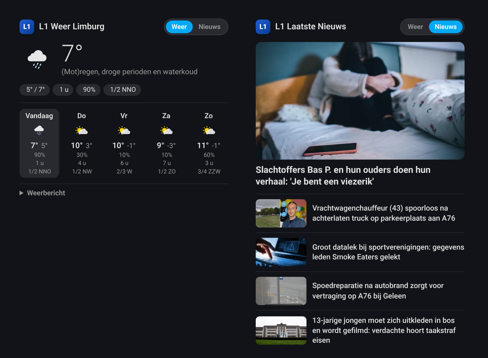

# L1 Weer & Nieuws Integration for Home Assistant

[](https://hacs.xyz/)
[](https://github.com/DonTranQuiL/l1-weer-en-nieuws/releases)
[](https://github.com/DonTranQuiL/l1-weer-en-nieuws/commits/main)
[](https://www.home-assistant.io/)
[](https://discord.gg/qaHPTTKHae)
[](https://liberapay.com/Malosaaa/donate)
[](https://liberapay.com/Malosaaa/donate)

This custom component for Home Assistant allows you to monitor up-to-date weather data and the latest news specifically for the Limburg region from [L1 Nieuws](https://www.l1nieuws.nl/). It works by scraping the data directly from the L1 website, providing detailed weather forecasts and news articles without requiring an official API.

> **Disclaimer:** This integration relies on web scraping. If L1 Nieuws drastically changes the HTML structure of its website, this integration might break until it is updated. The integration is built with a smart randomized interval to prevent overloading their servers.

***

## Features

* ✅ **Easy UI-Based Setup**: Configure entirely through the Home Assistant user interface. No `configuration.yaml` required for setup.
* ✅ **Multi-Sensor Data**: Scrapes current temperature, sun hours, precipitation, wind speed, and a clean 5-day forecast.
* ✅ **Optional News Scraper**: Automatically fetches the top 5 latest news articles (Title, Link, and Image). This can be toggled on or off at any time.
* ✅ **Smart Persistent Cache**: Saves data locally. Home Assistant boots up lightning-fast with the last known data without immediately hammering the L1 website.
* ✅ **Robust Service Calls**: Includes custom actions to manually refresh data, wipe the cache, or clear debug files.
* ✅ **Diagnostic Sensors**: Includes sensors to monitor the health, update status, and cache usage of the integration.
* ✅ **Rich Attributes**: Highly detailed attributes attached to the sensors, making it incredibly powerful for complex automations.

## Installation

### Method 1: Marketplace (Home Assistant 2026.11 and newer, recommended)

[](https://my.home-assistant.io/redirect/marketplace_repository/?owner=DonTranQuiL&repository=L1-Weer-en-Nieuws&category=integration)

1. In Home Assistant, go to **Settings > Marketplace** and search for **L1 Weer & Nieuws** (or use the button above).
2. Open it and select **Install**. The setup starts right away, no restart needed.

> **Not in the Marketplace catalog yet?** L1 Weer & Nieuws is not in the HACS default list yet, so it does not show up in the Marketplace search. Until it is, select **Add from link** in the upper-right corner of the Marketplace, enter `https://github.com/DonTranQuiL/L1-Weer-en-Nieuws`, select **Add**, then open L1 Weer & Nieuws and select **Install**.

### Method 2: HACS (Home Assistant Community Store) - Home Assistant before 2026.11

1.  Ensure you have [HACS](https://hacs.xyz/) installed.
2.  Go to HACS -> Integrations -> Click the 3-dots menu in the top right -> **Custom Repositories**.
3.  In the "Repository" field, paste this URL: `https://github.com/DonTranQuiL/L1-Weer-en-Nieuws`
4.  For "Category", select **Integration**.
5.  Click **Add**.
6.  The "L1 Weer & Nieuws" integration will now appear in your HACS integrations list. Click **Install** or **Download**.
7.  Restart Home Assistant.

### Method 3: Manual Installation

1.  Using a file access tool (like Samba or File Editor), navigate to the `custom_components` directory in your Home Assistant `config` folder.
2.  Create a new folder named `l1_weer`.
3.  Copy all the files from this repository into the new `l1_weer` folder.
4.  Restart Home Assistant.

## Configuration & Options

After installing and restarting, you can set up the integration.

1.  Navigate to **Settings** -> **Devices & Services**.
2.  Click the **+ ADD INTEGRATION** button in the bottom right.
3.  Search for "**L1 Weer & Nieuws**" and select it.
4.  You will be prompted to choose if you want to enable the News scraper and Debug mode. Click **Submit**.

**Adjusting Options Later:**
You can click the **Configure** button on the integration card at any time to:
* Toggle the News fetching on or off.
* Turn **Debug Mode** on or off (useful for troubleshooting; writes a raw HTML copy to a `scrape_output.txt` file in the integration folder).

## Sensors Provided

The integration creates the following sensors. All predictive data and news articles are stored as attributes within these main sensors.

| Sensor Name | Entity ID | Description |
| :--- | :--- | :--- |
| **Current Temperature** | `sensor.l1_huidige_temperatuur` | Main weather sensor. State is the current temperature in °C. Attributes contain today's conditions (`Zon`, `Neerslag`, `Wind`, `condition`, `temp_min`, `temp_max`, `condition_icon`, `description`) and the 5-day forecast (`dag_1_temperatuur`, `dag_1_min`, `dag_1_zonuren`, `dag_1_neerslag`, `dag_1_windkracht`, ... and a structured `forecast` list). `dag_1` is today. |
| **Latest News** | `sensor.l1_laatste_nieuws` | State is the number of articles found. Attributes contain the top 5 articles (`artikel_1_titel`, `artikel_1_link`, `artikel_1_afbeelding`, etc.) and the same articles as a `nieuws` list. |
| **Last Update** | `sensor.l1_weer_laatste_update` | (Diagnostic) Timestamp of the last successful web scrape or "Uit Cache". |
| **Status** | `sensor.l1_weer_status` | (Diagnostic) Shows "OK" or "Fout" and includes cache usage details in attributes. |

## Service Calls (Actions)

This integration provides three highly useful services that you can use in your automations or trigger manually via the **Developer Tools > Services** panel:

| Service | Description |
| :--- | :--- |
| `l1_weer.manual_refresh` | Forces an immediate update of the weather and news data, ignoring the standard background timer. |
| `l1_weer.clear_cache` | Clears the local JSON cache stored in Home Assistant. Very useful if the data appears stuck or corrupt. |
| `l1_weer.clear_debug_file` | Deletes the `scrape_output.txt` debug file from the integration directory to save space when debug mode is on. |

## Automations & Attributes

The sensors contain dozens of hidden attributes under the hood, making the automation possibilities endless. 

### Example: High Wind Warning Notification
Here is an example of how you can trigger a push notification to your phone if high winds (wind force 5 or above) are predicted for today (`dag_1`):

```yaml
alias: "L1 Weather: High Wind Warning"
trigger:
  - platform: numeric_state
    entity_id: sensor.l1_huidige_temperatuur
    attribute: dag_1_windkracht
    above: 4
action:
  - service: notify.notify
    data:
      title: "🌬️ Wind Warning"
      message: "Attention! Wind force {{ state_attr('sensor.l1_huidige_temperatuur', 'dag_1_windkracht') }} is predicted today in Limburg. Secure loose items in your garden!"
mode: single
```

## Dashboard Card

The integration ships its own dashboard card, **L1 Weer & Nieuws** (`custom:l1-card`). It is loaded automatically once the integration is set up, so there is no separate frontend download or resource to add. One card shows both the weather and the news, with a **Weer | Nieuws** switch in the header. The card remembers the last view you picked on that device.

* **Weer**: current temperature with the L1 weather icon and summary, today's min/max, sun, rain and wind, a 5-day forecast (icon, max/min, rain, sun, wind), and the full L1 forecast text that you can fold open.
* **Nieuws**: the lead story as a large photo with its title, then the other stories as compact rows. Each story opens on l1nieuws.nl in a new tab.

Add it through **Edit dashboard > Add card > L1 Weer & Nieuws**, or in YAML:

```yaml
type: custom:l1-card
```

All options are optional:

```yaml
type: custom:l1-card
initial_view: weather          # weather or news: what the card shows first
title: L1 Limburg              # default: "L1 Weer Limburg" / "L1 Laatste Nieuws"
entity_weather: sensor.l1_huidige_temperatuur
entity_news: sensor.l1_laatste_nieuws
max_articles: 5                # 1-10
show_forecast: true            # 5-day row in the weather view
show_description: true         # foldable L1 forecast text
```

If you renamed the sensors, the card finds them by itself; you can also choose them in the card editor.

> After updating the integration, restart Home Assistant once and reload the browser so the new card and parser are used. If the browser still shows the old card, clear its cache.



*Left: the Weer view. Right: the Nieuws view (same card, switched with the header buttons).*

***

## Support

Everything here is free and open source. If it saves you time, you can support the work:

<a href="https://ko-fi.com/DonTranQuiL"></a> <a href="https://liberapay.com/Malosaaa/donate"></a>
